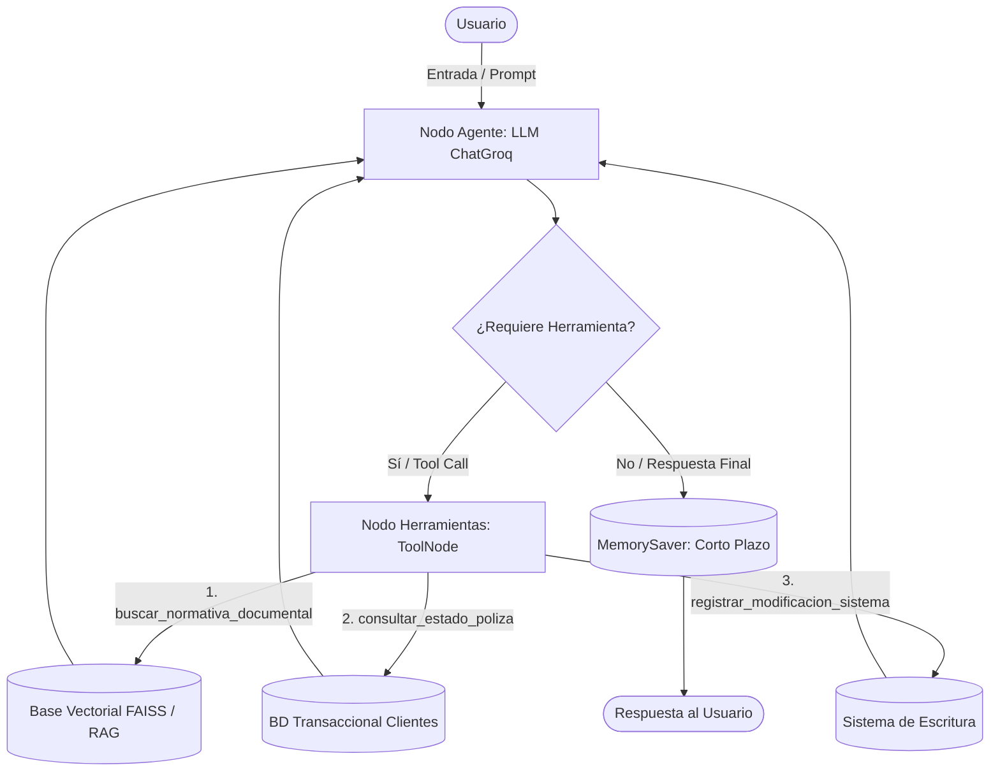

# Sistema de Agente Inteligente para Automatización Organizacional - Aseguradora del Pacífico

## 1. Descripción General del Proyecto

Este repositorio contiene la implementación técnica correspondiente a la **Evaluación Parcial 2 (EP2)** de la asignatura *Ingeniería de Soluciones con IA (ISY0101)*. El proyecto evoluciona desde un prototipo básico hacia un **agente inteligente autónomo y funcional**, diseñado para resolver requerimientos organizacionales en el rubro asegurador (*Aseguradora del Pacífico*).

El sistema integra capacidades avanzadas de consulta transaccional, recuperación semántica de normativas (RAG), escritura/registro en bases de datos y persistencia conversacional en flujos prolongados, utilizando arquitecturas basadas en grafos de estado (**LangGraph**), procesamiento de lenguaje de alta velocidad (**Groq** con `openai/gpt-oss-20b`) y frameworks modernos de IA.

---

## 2. Arquitectura del Sistema y Módulos

La solución se ha estructurado bajo un enfoque modular desacoplado, garantizando escalabilidad y compatibilidad técnica:

```
/proyecto-aseguradora-ep2
│
├── 1. Módulo de Inicialización y Configuración Segura (Google Colab Secrets / GROQ_API_KEY)
├── 2. Módulo de Memoria de Largo Plazo / RAG (FAISS & FakeEmbeddings)
├── 3. Módulo de Herramientas de Negocio (Tools: Consulta, Escritura y Razonamiento)
├── 4. Módulo de Orquestación y Grafo de Estados (LangGraph & MemorySaver)
└── 5. Módulo de Ejecución y Pruebas (Validación de Sesiones Multiturno)
```

---

## 3. Diagrama de Orquestación y Flujo de Trabajo

El siguiente diagrama detalla cómo interactúan los componentes dentro del grafo de ejecución de `LangGraph` al procesar una consulta del usuario:



---

## 4. Ejemplos de Flujos de Trabajo (Casos de Prueba)

### **Flujo 1: Consulta Institucional (Recuperación Semántica RAG)**
* **Entrada del Usuario:** 
  > *"¿Qué cubren las pólizas vehiculares en Aseguradora del Pacífico?"*
* **Proceso del Agente:**
  1. El LLM detecta que necesita información normativa y genera una llamada a la herramienta `buscar_normativa_documental`.
  2. El recuperador FAISS busca en la base documental institucional y devuelve los detalles de la póliza `POL-V01`.
  3. El agente procesa la información y emite una respuesta estructurada con formato claro.

### **Flujo 2: Consulta Transaccional y Continuidad de Memoria (Corto Plazo)**
* **Entrada del Usuario (Turno Siguiente):** 
  > *"Excelente. Ahora revísame el estado del cliente con ID CLI-001."*
* **Proceso del Agente:**
  1. Gracias al uso de `MemorySaver` vinculado al `thread_id` (`sesion-evaluacion-ep2-groq-01`), el agente conserva el contexto de la conversación previa.
  2. El LLM identifica que debe consultar datos transaccionales y ejecuta la herramienta `consultar_estado_poliza` con el parámetro `CLI-001`.
  3. Se recupera el registro de *Juan Pérez* con póliza `POL-9981` y estado `Vigente`, cerrando el ciclo operativo con autonomía.

---

## 5. Decisiones de Diseño Técnico

* **Elección del Proveedor de Inferencia (Groq):** Optimiza la latencia de inferencia garantizando respuestas en tiempo real para demostraciones en vivo, manteniendo compatibilidad total con *tool-calling*.
* **Gestión de Embeddings Locales (`FakeEmbeddings`):** Evita dependencias externas de costos o limitaciones de red en entornos académicos controlados.
* **Persistencia de Estado Basada en Grafos:** A diferencia de las cadenas lineales, `LangGraph` ofrece control determinista sobre las transiciones y robustez ante fallos.

---

## 6. Instrucciones de Instalación y Ejecución

1. **Instalación de Dependencias:**
   ```python
   !pip install -q langchain langchain-groq langchain-community faiss-cpu python-dotenv langgraph
   ```
2. **Carga Segura de Credenciales:** Configure su clave en los secretos de Colab como `GROQ_API_KEY`.
3. **Ejecución del Agente:** Ejecute secuencialmente los bloques de RAG, herramientas, orquestación y el bloque de pruebas multiturno con el `thread_id` correspondiente.
